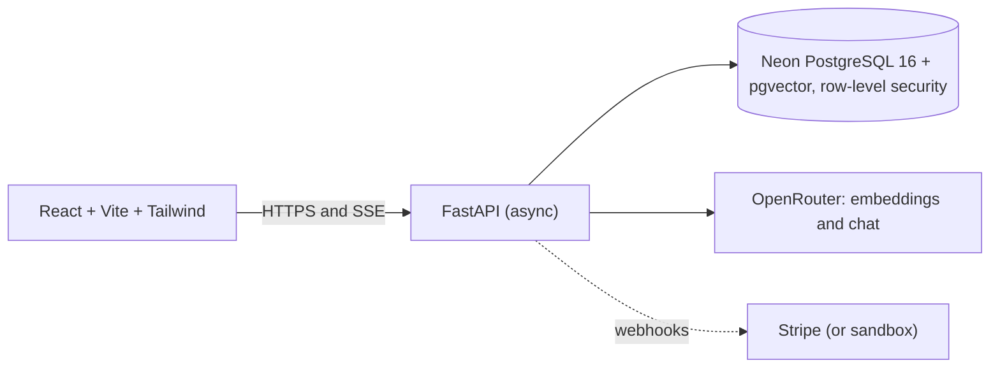

# THE AIRLINE

A multi-tenant RAG SaaS: upload documents, then chat with them. Every answer is drawn only from what the workspace uploaded, streams in token by token, and is isolated per workspace by the database itself.

> Add a screenshot or two here (`docs/screenshot-chat.png`) once the app is deployed.

## Features

- **Multi-tenant isolation in PostgreSQL**: row-level security with a `NOBYPASSRLS` role; every request runs `SET LOCAL ROLE` and a per-transaction tenant id. A forgotten `WHERE` clause cannot leak data across workspaces.
- **RAG pipeline**: PDF, Word, text and code uploads, paragraph-aware chunking, embeddings through OpenRouter, cosine search in pgvector.
- **Document picking**: answer from all documents or only the ones you tick.
- **SSE streaming** with exact token accounting, including when the user clicks Stop mid-answer.
- **Semantic cache** with a stampede lock: repeated questions cost zero tokens.
- **Two-door rate limiting**: a Postgres token bucket in front of the cache, a monthly quota behind it.
- **Idempotency keys** with zombie-lock expiry on uploads and checkout.
- **Billing** with raw-byte HMAC webhook verification and a `sandbox_no_bank` mode that needs no Stripe account; a real Stripe key switches to live checkout with no code change.
- **Feature flags**: a global AI kill switch plus per-workspace overrides.
- **Chat history, pins, themes**: Markdown answers, a sliding sidebar and documents panel, light and dark mode.

## Architecture



Design decisions are written up in [`backend/docs/adr`](backend/docs/adr):

1. Postgres row-level security for multi-tenancy
2. Server-Sent Events over WebSockets
3. Client idempotency keys and HMAC-verified webhooks

## Stack

FastAPI, SQLAlchemy 2.0 (asyncpg), Alembic, PostgreSQL 16 with pgvector (Neon), OpenRouter, Argon2 and JWT, React 18, Vite, Tailwind CSS 3, Docker, Nginx.

## Run it locally

You need Docker Desktop, a Neon database (free tier works) and an OpenRouter API key with a little credit.

```bash
cp backend/.env.example backend/.env
# edit backend/.env: DATABASE_URL, JWT_SECRET, OPENROUTER_API_KEY

docker build -t airline-api backend
docker build -t airline-web --build-arg VITE_API_URL=http://127.0.0.1:8001 frontend

docker run --rm --env-file backend/.env -p 8001:8000 airline-api
docker run --rm -p 5173:80 airline-web
```

Open http://127.0.0.1:5173 and create an account. The API container applies database migrations on start.

## Configuration

All settings are environment variables; nothing is hard-coded, so handing the project to a client means changing values, not code.

| Variable | Purpose |
|---|---|
| `DATABASE_URL` | Neon connection string (copied as-is; it is converted for asyncpg automatically) |
| `JWT_SECRET` | signs access tokens; use a long random string |
| `OPENROUTER_API_KEY` | embeddings and chat |
| `OPENROUTER_CHAT_MODEL`, `OPENROUTER_EMBEDDING_MODEL` | model names (embeddings must be 1536 dimensions) |
| `CORS_ORIGINS`, `FRONTEND_URL` | the frontend's origin(s) |
| `STRIPE_SECRET_KEY` | `sandbox_no_bank` for demos, or a real `sk_test_` / `sk_live_` key |
| `STRIPE_WEBHOOK_SECRET`, `STRIPE_PRO_PRICE_ID` | live Stripe only (the price must be recurring) |
| `N8N_WEBHOOK_URL` | optional, leave empty to disable |

## Project layout

```
backend/    FastAPI app, Alembic migration (RLS, pgvector, feature flags), ADRs, Dockerfile
frontend/   React app, Nginx config, Dockerfile
```

## Status and known limitations

- Broad requests such as "summarize everything" work poorly: retrieval finds the closest passages, not the whole document.
- Each question is answered on its own; earlier messages are shown in history but are not sent to the model.
- The monthly token counter is not reset automatically.
- Sign-up is open, and `sandbox_no_bank` upgrades a workspace to Pro without payment. Switch both off before real clients use it.
- Pinned chats are stored in the browser, not on the server.

## License

MIT, see [LICENSE](LICENSE).